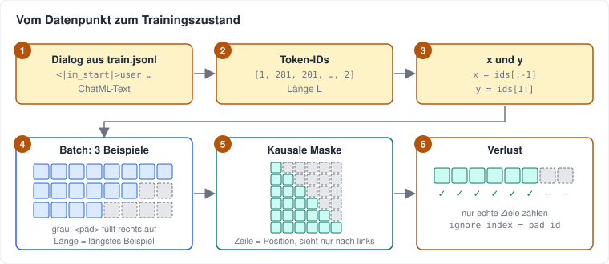

# Gruppe A: Vom Dialog zum Trainingsbatch

**Transformer, Sitzung 2 · Arbeitsblatt A · entschärfte Fassung**

> **Leitfrage:** Wie sieht ein Trainingsbatch aus, und wie sorgen die Masken dafür, dass das Modell beim Lernen nicht abschreibt?

> **Quelle:** Bearbeitete, entschärfte Fassung der Arbeitsblätter aus [iludis52/DQR6_Material](https://github.com/iludis52/DQR6_Material) (Transformer, Sitzung 2). Das Notebook `guppylm_lehrnotebook_b.ipynb` liegt dort im Ordner [M2a_Transformer](https://github.com/iludis52/DQR6_Material/tree/main/M2a_Transformer). Das Experiment ist von dort übernommen.

## So arbeiten Sie

1. **Erst vorhersagen, dann messen.** Notieren Sie Ihre Erwartung, bevor Sie eine Zelle ausführen. Eine nicht bestätigte Erwartung ist ein Ergebnis.
2. Arbeiten Sie mit **Variante b** (`guppylm_lehrnotebook_b.ipynb`) und dem fertigen Checkpoint. Ein neues Training ist nicht nötig. Führen Sie das Notebook bis einschließlich der Zelle mit `lade_checkpoint` aus und überspringen Sie dabei die Trainingszelle. Die Experiment-Zelle fügen Sie ganz unten an.
3. Der Datensatz ist englisch. Stellen Sie Guppy englische Fragen.
4. Zeitvorschlag (75 min): Lesen 10 · Verstehen 25 · Experiment 25 · Ergebnis 15.

## 1. Worum es geht

Ein Sprachmodell lernt, das jeweils **nächste Token** vorherzusagen. Die richtigen Antworten stehen schon im Text: Man verschiebt die Tokenfolge um eine Position. Aus `ids` wird die Eingabe `x = ids[:-1]` und das Ziel `y = ids[1:]`. An jeder Position soll das Modell also das Token vorhersagen, das im Text direkt danach kommt.

Mehrere Dialoge werden zu einem **Batch** zusammengefasst. Weil sie unterschiedlich lang sind, füllt das Skript kürzere Zeilen rechts mit dem Füll-Token `<pad>` auf. Zwei Mechanismen sorgen dafür, dass dabei nichts schiefgeht:

- Die **kausale Maske** in der Attention: Position *t* darf nur die Positionen 0 bis *t* sehen, nie die Zukunft.
- `ignore_index=pad_id` im Verlust: Positionen, deren Ziel ein `<pad>` ist, zählen nicht.



## 2. Lesen

Suchen Sie im Notebook die Funktionen `zu_sequenzen`, `baue_batch` und `kausale_maske` und lesen Sie die Zelle, die direkt nach `baue_batch` einen Beispiel-Batch ausgibt.

1. Wie entstehen in `baue_batch` die Tensoren `x` und `y` aus einer Tokenliste?
2. Woran erkennt man in der Ausgabe der Beispielzelle, dass `y` gegenüber `x` um eine Position verschoben ist?

## 3. Verstehen

1. **Batch:** Welche Form hat ein Batch (Zeilen × Spalten), und wovon hängt die Zahl der Spalten ab? Wie viele Vorhersageaufgaben stecken in einem Dialog mit *L* Tokens?
2. **Kausale Maske:** Was würde passieren, wenn Position 3 beim Training die Position 4 sehen dürfte? Tipp: Was steht in `x` an Position 4, und was ist das Ziel an Position 3?
3. **Padding:** Warum darf ein `<pad>`-Ziel nicht in den Verlust eingehen? Wo im Code steht das?

## 4. Experiment: Kann das Modell in die Zukunft schauen?

Zwei Eingaben sind bis zur Position `p = 5` gleich und unterscheiden sich erst danach. Wenn die Maske wirkt, dürfen sich die Ausgaben bis Position 5 nicht unterscheiden.

**a) Erwartung.** Kreuzen Sie an, bevor Sie die Zelle ausführen.

| | Abweichung bis `p` | Abweichung nach `p` |
|---|---|---|
| mit Maske | ☐ null ☐ nicht null | ☐ null ☐ nicht null |
| ohne Maske | ☐ null ☐ nicht null | ☐ null ☐ nicht null |

**b) Versuch.** Die Zelle braucht kein trainiertes Modell.

```python
torch.manual_seed(0)
probe = GuppyLM(konfig).eval()
T, p = 12, 5

a = torch.randint(3, konfig.vocab_size, (1, T))
b = a.clone()
b[0, p + 1:] = torch.randint(3, konfig.vocab_size, (T - p - 1,))   # nur nach p anders

def vergleiche(titel):
    with torch.no_grad():
        la, _ = probe(a)
        lb, _ = probe(b)
    bis = (la[0, :p + 1] - lb[0, :p + 1]).abs().max().item()
    nach = (la[0, p + 1:] - lb[0, p + 1:]).abs().max().item()
    print(f"{titel}: größte Abweichung bis p = {bis:.2e}, nach p = {nach:.2e}")

vergleiche("mit Maske ")
maske_original = kausale_maske                       # Maske kurz abschalten …
kausale_maske = lambda T, device=None: torch.ones(T, T, device=device).view(1, 1, T, T)
vergleiche("ohne Maske")
kausale_maske = maske_original                       # … und unbedingt wiederherstellen
```

**c) Beobachtung.** Tragen Sie die vier Werte ein und vergleichen Sie mit Ihrer Erwartung.

**d) Erklärung.**

1. Warum ist die Abweichung „bis p“ mit Maske genau null?
2. Was würde das Modell ohne Maske beim Training lernen, und warum wäre es danach beim Erzeugen von Antworten nutzlos?

## 5. Ihr Ergebnis fürs Plenum (etwa 5 Minuten)

- **Grafik:** Übertragen Sie die Grafik oben auf ein Plakat oder eine Folie und füllen Sie die Stationen ① bis ⑥ mit einem echten Dialog aus dem Notebook: Text, einige Token-IDs, `x` und `y`.
- **Beleg:** die vier Messwerte aus dem Experiment.
- **Eine Kernaussage:** Warum liefert ein einziger Dialog viele Trainingsaufgaben auf einmal, ohne dass das Modell abschreiben kann?
