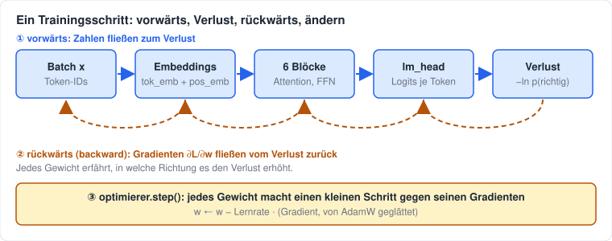

# Gruppe B: Der Verlust und sein Weg zurück ins Netz

**Transformer, Sitzung 2 · Arbeitsblatt B · entschärfte Fassung**

> **Leitfrage:** Warum verwendet das Skript genau diesen Verlust, und wie verändert er die Gewichte des Netzes?

> **Quelle:** Bearbeitete, entschärfte Fassung der Arbeitsblätter aus [iludis52/DQR6_Material](https://github.com/iludis52/DQR6_Material) (Transformer, Sitzung 2). Das Notebook `guppylm_lehrnotebook_b.ipynb` liegt dort im Ordner [M2a_Transformer](https://github.com/iludis52/DQR6_Material/tree/main/M2a_Transformer).

## So arbeiten Sie

1. **Erst vorhersagen, dann messen.** Notieren Sie Ihre Erwartung, bevor Sie eine Zelle ausführen. Eine nicht bestätigte Erwartung ist ein Ergebnis.
2. Arbeiten Sie mit **Variante b** (`guppylm_lehrnotebook_b.ipynb`) und dem fertigen Checkpoint. Ein neues Training ist nicht nötig. Führen Sie das Notebook bis einschließlich der Zelle mit `lade_checkpoint` aus und überspringen Sie dabei die Trainingszelle. Die Experiment-Zelle fügen Sie ganz unten an.
3. Der Datensatz ist englisch. Stellen Sie Guppy englische Fragen.
4. Zeitvorschlag (75 min): Lesen 10 · Verstehen 25 · Experiment 25 · Ergebnis 15.

## 1. Worum es geht

Das Modell gibt an jeder Position für **jedes** der rund 2.600 Tokens eine Wahrscheinlichkeit aus. Der Verlust schaut nur auf eine einzige davon: die Wahrscheinlichkeit *p*, die das Modell dem **tatsächlich folgenden** Token gegeben hat.

$$
\mathcal L = -\ln p_{\text{richtig}}
$$

Ist das Modell sicher und richtig (*p* nahe 1), ist der Verlust fast 0. Gibt es dem richtigen Token kaum Chancen, wird der Verlust groß. Das heißt **Kreuzentropie**; im Code steht dafür `F.cross_entropy`.

Ein Trainingsschritt hat drei Teile. Die Vorwärtsrechnung ergibt den Verlust. Die **Backpropagation** (`verlust.backward()`) berechnet für jedes einzelne Gewicht, wie stark und in welche Richtung es den Verlust beeinflusst. Das ist sein Gradient. Erst `optimierer.step()` verändert die Gewichte dann ein kleines Stück in die Richtung, die den Verlust senkt.



## 2. Lesen

Suchen Sie im Notebook in `GuppyLM.forward` die Zeilen mit `F.cross_entropy` und in der Trainingszelle die Zeilen mit `backward`, `clip_grad_norm_` und `optimierer.step`.

1. Welche zwei Dinge bekommt `F.cross_entropy` übergeben, und was bedeutet `ignore_index`?
2. In welcher Reihenfolge stehen `verlust.backward()`, `optimierer.step()` und `optimierer.zero_grad()` in der Schleife?

## 3. Verstehen

1. **Rechnen.** Berechnen Sie $-\ln p$ für $p = 0{,}9$, $p = 0{,}1$ und $p = 0{,}01$. Was fällt Ihnen auf?

| *p* für das richtige Token | 0,9 | 0,1 | 0,01 |
|---|---|---|---|
| Verlust $-\ln p$ | | | |

2. **Warum kein anderer Verlust?** Man könnte den Abstand zwischen vorhergesagter und richtiger Token-ID messen, etwa (ID − Ziel-ID)². Warum wäre das unsinnig? Tipp: Ist Token 500 einem Token 501 „ähnlicher“ als Token 2000?
3. **Startwert.** Ein untrainiertes Modell verteilt seine Wahrscheinlichkeit ungefähr gleichmäßig auf alle *V* Tokens. Welchen Verlust erwarten Sie dann? Rechnen Sie mit *V* = 2597.
4. **Backpropagation.** Erklären Sie in eigenen Worten mit der Grafik: Was fließt vorwärts, was fließt rückwärts, und welche Zeile ändert tatsächlich Gewichte?

## 4. Experiment: Ein einziger Trainingsschritt

Sie nehmen ein **frisches, untrainiertes** Modell und machen genau einen Trainingsschritt auf einem Batch. Gemessen wird der Verlust davor und danach, auf diesem Batch und auf einem anderen.

**a) Erwartung.**
- Wie groß ist der Verlust vorher (Ihre Rechnung aus Aufgabe 3)?
- Sinkt er nach einem Schritt deutlich, kaum oder gar nicht? Und auf dem anderen Batch?
- Welcher Anteil der Gewichte wird durch einen Schritt verändert: wenige, die Hälfte, fast alle?

**b) Versuch.**

```python
torch.manual_seed(0)
lern_batch = baue_batch(train_seq, list(range(32)))
anderer_batch = baue_batch(train_seq, list(range(32, 64)))
frisch = GuppyLM(konfig).to(DEVICE).eval()   # untrainiertes Modell; eval() schaltet Dropout ab
opt = torch.optim.AdamW(frisch.parameters(), lr=3e-4)

def verlust_auf(batch):
    x, y = batch
    with torch.no_grad():
        return frisch(x.to(DEVICE), y.to(DEVICE))[1].item()

vorher = {n: p.detach().clone() for n, p in frisch.named_parameters()}
print(f"vorher : Lern-Batch {verlust_auf(lern_batch):.3f} | anderer Batch {verlust_auf(anderer_batch):.3f}")

x, y = lern_batch
_, verlust = frisch(x.to(DEVICE), y.to(DEVICE))   # 1. vorwärts: Verlust
verlust.backward()                                  # 2. rückwärts: Gradienten
opt.step()                                          # 3. Gewichte ändern

print(f"nachher: Lern-Batch {verlust_auf(lern_batch):.3f} | anderer Batch {verlust_auf(anderer_batch):.3f}")
for teil in ("tok_emb", "pos_emb", "blocks.0.", "blocks.5.", "norm."):
    geaendert = gesamt = 0
    for n, p in frisch.named_parameters():
        if n.startswith(teil):
            geaendert += (p.detach() != vorher[n]).sum().item()
            gesamt += p.numel()
    print(f"{teil:10s} {geaendert / gesamt:6.1%} der Gewichte verändert")
```

**c) Beobachtung.**

| | Lern-Batch | anderer Batch |
|---|---|---|
| Verlust vorher | | |
| Verlust nachher | | |

**d) Erklärung.**

1. Passt der Startwert zu Ihrer Rechnung aus Aufgabe 3?
2. Warum sinkt der Verlust auch auf dem anderen Batch, obwohl nur mit dem Lern-Batch trainiert wurde?
3. Ein Teil verändert sich gar nicht. Welcher, und warum? Tipp: Was ist in Variante b an der Positionstabelle besonders?

## 5. Ihr Ergebnis fürs Plenum (etwa 5 Minuten)

- **Grafik:** Zeichnen Sie die Grafik oben nach und tragen Sie an ① den Verlust vorher, an ② „Gradienten für alle Gewichte“ und an ③ den Verlust nachher aus Ihrem Experiment ein.
- **Beleg:** Ihre Handrechnung zu −ln p und die Verlustwerte vor und nach dem Schritt.
- **Eine Kernaussage:** Warum ist −ln p ein gutes Maß für „Wie gut hat das Modell das nächste Token vorhergesagt?“, und wie wird daraus eine Änderung der Gewichte?
