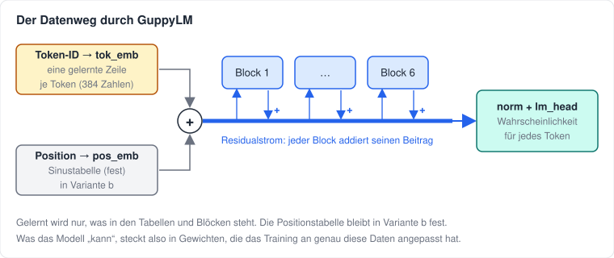

# Gruppe C: Was kann das Netz am Ende?

**Transformer, Sitzung 2 · Arbeitsblatt C · entschärfte Fassung**

> **Leitfrage:** Was hat Guppy nach dem Training gelernt, wo steckt dieses Wissen, und welche Rolle spielen Embeddings und Positionen?

> **Quelle:** Bearbeitete, entschärfte Fassung der Arbeitsblätter aus [iludis52/DQR6_Material](https://github.com/iludis52/DQR6_Material) (Transformer, Sitzung 2). Das Notebook `guppylm_lehrnotebook_b.ipynb` liegt dort im Ordner [M2a_Transformer](https://github.com/iludis52/DQR6_Material/tree/main/M2a_Transformer).

## So arbeiten Sie

1. **Erst vorhersagen, dann messen.** Notieren Sie Ihre Erwartung, bevor Sie eine Zelle ausführen. Eine nicht bestätigte Erwartung ist ein Ergebnis.
2. Arbeiten Sie mit **Variante b** (`guppylm_lehrnotebook_b.ipynb`) und dem fertigen Checkpoint. Ein neues Training ist nicht nötig. Führen Sie das Notebook bis einschließlich der Zelle mit `lade_checkpoint` aus und überspringen Sie dabei die Trainingszelle. Die Experiment-Zelle fügen Sie ganz unten an.
3. Der Datensatz ist englisch. Stellen Sie Guppy englische Fragen.
4. Zeitvorschlag (75 min): Lesen 10 · Verstehen 25 · Experiment 25 · Ergebnis 15.

## 1. Worum es geht

Am Eingang schlägt das Modell für jedes Token eine Zeile in der **Token-Tabelle** `tok_emb` nach: 384 Zahlen, die während des Trainings gelernt werden. Weil Attention die Reihenfolge der Tokens nicht von selbst kennt, wird eine Zeile aus der **Positionstabelle** `pos_emb` addiert. In Variante b ist diese Tabelle fest berechnet (Sinus und Kosinus) und wird nicht trainiert.

Danach laufen die Vektoren durch sechs Blöcke. Jeder Block **addiert** seinen Beitrag zum bisherigen Vektor (Residualverbindung). Gruppe D untersucht das genauer. Am Ende macht `lm_head` daraus eine Wahrscheinlichkeit für jedes Token.

Alles, was Guppy „kann“, steckt in diesen gelernten Zahlen. Gelernt hat er sie aus genau einem Datensatz: rund 57.000 kurzen Gesprächen mit einem Goldfisch.



## 2. Lesen

Suchen Sie im Notebook die Klasse `GuppyLM` (vor allem `__init__` und `forward`), die Funktion `sinus_tabelle` und die Zelle mit der Parameterbilanz (Tabelle „Bauteil, Parameter, Anteil“).

1. Welche zwei Zeilen in `forward` bilden den Eingangsvektor, und wie werden sie verknüpft?
2. Welcher Anteil der Parameter steckt in den Embeddings, welcher in den sechs Blöcken?

## 3. Verstehen

1. **Was kann Guppy?** Beschreiben Sie in zwei Sätzen, worauf Guppy gut antwortet und worauf nicht. Begründen Sie mit den Trainingsdaten.
2. **Embeddings.** Die Token-ID ist nur eine Nummer. Warum braucht das Modell stattdessen einen Vektor mit 384 Zahlen?
3. **Positionen.** Was wüsste das Modell nicht, wenn man `pos_emb` weglässt? Bilden Sie ein Beispiel, bei dem die Reihenfolge der Wörter den Sinn ändert.
4. **Residual, kurz.** Was bedeutet „jeder Block addiert seinen Beitrag“ für den Vektor, der am Ende bei `lm_head` ankommt?

## 4. Experiment: Bekannt, umformuliert, fremd

Sie stellen dem fertigen Modell drei Arten von Fragen bei **Temperatur 0**. Dann wählt es immer das wahrscheinlichste Token, und die Antwort ist reproduzierbar.

**a) Erwartung.** Was antwortet Guppy jeweils?

| Frage | Typ | Ihre Erwartung |
|---|---|---|
| `are you hungry` | steht so im Training | |
| `do you want some food right now` | gleiche Bedeutung, neu formuliert | |
| `what is the capital of france` | Thema kommt im Training nicht vor | |

**b) Versuch.** Sie können die Liste um eigene Fragen ergänzen.

```python
train_fragen = {t.split("user\n", 1)[1].split("<|im_end|>", 1)[0] for t in texte["train"]}
fragen = ["are you hungry", "do you want some food right now", "what is the capital of france"]

for frage in fragen:
    bekannt = "bekannt" if frage in train_fragen else "neu    "
    text, grund = antworte(frage, temperatur=0, return_info=True)
    print(f"[{bekannt}] {frage:35s} -> {text} [{grund}]")

werte = modell.pos_emb.weight.detach().cpu()        # die Positionstabelle ansehen
plt.figure(figsize=(7, 2.5))
plt.imshow(werte.numpy(), aspect="auto", cmap="RdBu_r")
plt.xlabel("Dimension"); plt.ylabel("Position"); plt.colorbar()
plt.show()
```

**c) Beobachtung.** Notieren Sie die drei Antworten und beschreiben Sie das Muster der Heatmap in einem Satz.

**d) Erklärung.**

1. Warum antwortet Guppy auch auf die neu formulierte Frage sinnvoll, obwohl er sie nie gesehen hat? Was haben die Embeddings damit zu tun?
2. Was macht Guppy bei der themenfremden Frage, und warum kann er es nicht besser?
3. Das Heatmap-Muster ist in jedem Training gleich. Warum?

## 5. Ihr Ergebnis fürs Plenum (etwa 5 Minuten)

- **Grafik:** Zeichnen Sie den Datenweg aus der Grafik oben nach und markieren Sie farbig, welche Teile gelernt werden und welche fest sind.
- **Beleg:** die drei Antworten aus dem Experiment.
- **Eine Kernaussage:** Was kann Guppy am Ende, und warum genau das und nicht mehr?
