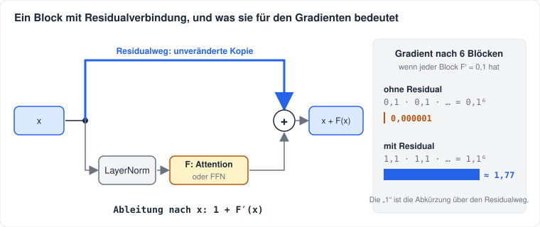

# Gruppe D: Die Residualverbindung

**Transformer, Sitzung 2 · Arbeitsblatt D · entschärfte Fassung**

> **Leitfrage:** Was leistet die Residualverbindung, und warum lässt sich ein Netz mit sechs Blöcken dadurch überhaupt trainieren?

> **Quelle:** Bearbeitete, entschärfte Fassung der Arbeitsblätter aus [iludis52/DQR6_Material](https://github.com/iludis52/DQR6_Material) (Transformer, Sitzung 2). Das Notebook `guppylm_lehrnotebook_b.ipynb` liegt dort im Ordner [M2a_Transformer](https://github.com/iludis52/DQR6_Material/tree/main/M2a_Transformer). Teil 2 des Experiments ist von dort übernommen.

## So arbeiten Sie

1. **Erst vorhersagen, dann messen.** Notieren Sie Ihre Erwartung, bevor Sie eine Zelle ausführen. Eine nicht bestätigte Erwartung ist ein Ergebnis.
2. Arbeiten Sie mit **Variante b** (`guppylm_lehrnotebook_b.ipynb`) und dem fertigen Checkpoint. Ein neues Training ist nicht nötig. Führen Sie das Notebook bis einschließlich der Zelle mit `lade_checkpoint` aus und überspringen Sie dabei die Trainingszelle. Die Experiment-Zelle fügen Sie ganz unten an.
3. Der Datensatz ist englisch. Stellen Sie Guppy englische Fragen.
4. Zeitvorschlag (75 min): Lesen 10 · Verstehen 25 · Experiment 25 · Ergebnis 15.

## 1. Worum es geht

Jeder Block im Transformer **ersetzt** seinen Eingangsvektor nicht, sondern **ergänzt** ihn:

$$
y = x + F(x)
$$

Dabei ist *F* die Attention oder das Feedforward-Netz, jeweils mit vorgeschalteter LayerNorm. Der Vektor *x* läuft unverändert auf einem eigenen Weg weiter, dem **Residualweg**. Am Pluszeichen kommt der Beitrag des Blocks hinzu.

Wichtig wird das beim Lernen: Der Gradient muss vom Verlust ganz hinten bis zu den Gewichten ganz vorne zurücklaufen. Ohne Residualweg wird er in jedem Block mit der Ableitung *F′* multipliziert. Ist *F′* klein, schrumpft das Signal von Block zu Block. Mit Residualweg ist die Ableitung eines Blocks **1 + F′**. Die „1“ ist eine Abkürzung, über die das Signal immer durchkommt.



## 2. Lesen

Suchen Sie im Notebook die Klasse `Block` und die Zelle direkt danach, die „relative Änderung durch den Block“ ausgibt.

1. In welchen zwei Zeilen von `Block.forward` stehen die Residualverbindungen?
2. Um wie viel Prozent verändert ein einzelner (noch untrainierter) Block den Vektor laut der Ausgabe?

## 3. Verstehen

1. **Skizze.** Zeichnen Sie einen Block mit **beiden** Additionen: eine für die Attention, eine für das FFN, jeweils mit LayerNorm davor.
2. **Rechnen.** Jeder der sechs Blöcke habe die Ableitung *F′* = 0,1. Mit welchem Faktor kommt ein Gradient vorne an, ohne und mit Residualverbindung?

| | ohne Residual: $0{,}1^6$ | mit Residual: $(1 + 0{,}1)^6$ |
|---|---|---|
| Faktor | | |

3. **Eigenschaften.** Füllen Sie die Tabelle aus.

| | Residualverbindung |
|---|---|
| Was sie tut (ein Satz) | |
| Vorteil für das Training | |
| Vorteil für die Darstellung („Block ergänzt nur“) | |
| Nachteil oder Voraussetzung | Tipp: Was muss für *x* und *F(x)* gelten, damit man sie addieren kann? Und was passiert mit der Größe des Vektors über viele Blöcke? |

## 4. Experiment: Kommt das Signal vorne an?

**a) Erwartung.**
- Teil 1 rechnet Ihr Zahlenbeispiel aus Aufgabe 2 mit PyTorch nach. Was kommt heraus?
- Teil 2 misst die echten Gradienten im trainierten Guppy. Block 0 liegt am weitesten vom Verlust entfernt, Block 5 am nächsten. Ist der Gradient in Block 0 kleiner, gleich oder größer als in Block 5?

**b) Versuch.**

```python
# Teil 1: das Zahlenbeispiel, mit automatischer Ableitung
for mit_residual in (False, True):
    x = torch.tensor(1.0, requires_grad=True)
    h = x
    for block in range(6):
        f = 0.1 * h                      # ein "Block", dessen Ableitung 0,1 ist
        h = h + f if mit_residual else f
    h.backward()
    print(f"mit Residual: {mit_residual!s:5s} -> Gradient vorne: {x.grad.item():.6f}")

# Teil 2: echte Gradienten im trainierten Modell
modell.train()
x, y = baue_batch(train_seq, list(range(32)))
_, verlust = modell(x.to(DEVICE), y.to(DEVICE))
modell.zero_grad(set_to_none=True)
verlust.backward()
for name, p in modell.named_parameters():
    if name.endswith("ffn.hoch.weight"):
        print(f"{name:28s} Gradientennorm {p.grad.norm():.4f}")
modell.zero_grad(set_to_none=True)
modell.eval()
```

**c) Beobachtung.**

| Block | 0 | 1 | 2 | 3 | 4 | 5 |
|---|---|---|---|---|---|---|
| Gradientennorm | | | | | | |

**d) Erklärung.**

1. Stimmt Teil 1 mit Ihrer Handrechnung überein?
2. Ist der Gradient in Block 0 verschwunden? Was wäre ohne Residualverbindung zu erwarten gewesen?

## 5. Ihr Ergebnis fürs Plenum (etwa 5 Minuten)

- **Grafik:** die Grafik oben mit Ihren Messwerten. Schreiben Sie an den Residualweg den Faktor „1“ und an den Block-Zweig „F′“ und tragen Sie die gemessenen Gradientennormen von Block 0 und Block 5 ein.
- **Beleg:** die Rechnung 0,1⁶ gegen 1,1⁶ und die sechs Gradientennormen.
- **Eine Kernaussage:** Warum kommt das Lernsignal durch sechs Blöcke hindurch vorne an, und was kostet die Residualverbindung?
