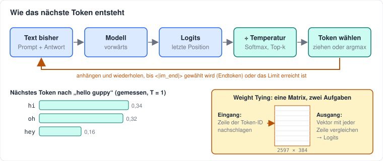

# Gruppe E: Das nächste Token

**Transformer, Sitzung 2 · Arbeitsblatt E · entschärfte Fassung**

> **Leitfrage:** Wie macht das fertige Modell aus einer Frage Token für Token eine Antwort, und was ist Weight Tying?

> **Quelle:** Bearbeitete, entschärfte Fassung der Arbeitsblätter aus [iludis52/DQR6_Material](https://github.com/iludis52/DQR6_Material) (Transformer, Sitzung 2). Das Notebook `guppylm_lehrnotebook_b.ipynb` liegt dort im Ordner [M2a_Transformer](https://github.com/iludis52/DQR6_Material/tree/main/M2a_Transformer). Teil 2 des Experiments ist von dort übernommen.

## So arbeiten Sie

1. **Erst vorhersagen, dann messen.** Notieren Sie Ihre Erwartung, bevor Sie eine Zelle ausführen. Eine nicht bestätigte Erwartung ist ein Ergebnis.
2. Arbeiten Sie mit **Variante b** (`guppylm_lehrnotebook_b.ipynb`) und dem fertigen Checkpoint. Ein neues Training ist nicht nötig. Führen Sie das Notebook bis einschließlich der Zelle mit `lade_checkpoint` aus und überspringen Sie dabei die Trainingszelle. Die Experiment-Zelle fügen Sie ganz unten an.
3. Der Datensatz ist englisch. Stellen Sie Guppy englische Fragen.
4. Zeitvorschlag (75 min): Lesen 10 · Verstehen 25 · Experiment 25 · Ergebnis 15.

## 1. Worum es geht

Guppy schreibt eine Antwort nicht auf einmal. Er sagt **ein** Token voraus, hängt es an den Text an und sagt dann das nächste voraus, so lange, bis er das Endtoken `<|im_end|>` wählt.

Für jede Vorhersage liefert das Modell **Logits**: eine Zahl pro Token im Vokabular. Die Softmax macht daraus Wahrscheinlichkeiten. Vorher werden die Logits durch die **Temperatur** geteilt:

- **Temperatur klein** (gegen 0): Das wahrscheinlichste Token gewinnt fast immer.
- **Temperatur groß**: Die Wahrscheinlichkeiten werden flacher, seltene Tokens kommen öfter dran.
- **Temperatur 0** heißt im Code: immer das wahrscheinlichste Token nehmen (argmax).

Die Logits entstehen in `lm_head`. Dafür nutzt GuppyLM **dieselbe Matrix** wie für die Token-Embeddings am Eingang. Das nennt man **Weight Tying**.



## 2. Lesen

Suchen Sie im Notebook die Funktionen `erzeuge` und `antworte` sowie in `GuppyLM.__init__` die Zeile `self.lm_head.weight = self.tok_emb.weight`.

1. Womit endet der Prompt, den `antworte` baut? Warum genau dort?
2. Welche drei Gründe gibt es, warum `erzeuge` aufhört?

## 3. Verstehen

1. **Nächstes Token.** Beschreiben Sie mit der Grafik die Schleife in `erzeuge` in vier Schritten.
2. **Vorhersage.** Warum benutzt das Modell nur die Logits der **letzten** Position?
3. **Weight Tying.** Die Matrix `tok_emb` hat die Form 2597 × 384. Wofür wird sie am Eingang benutzt, wofür am Ausgang? Wie viele Parameter spart das gegenüber einer eigenen Ausgabematrix?

## 4. Experiment: Dem Modell beim Schreiben zusehen

**a) Erwartung.**
- Wie sicher ist sich Guppy beim ersten Token seiner Antwort auf „hello guppy“? Eher über 90 % oder eher unter 50 %?
- Was passiert mit den Top-5-Wahrscheinlichkeiten, wenn die Temperatur von 0,1 auf 1,5 steigt? Ändert sich die **Reihenfolge**?
- Sind `lm_head.weight` und `tok_emb.weight` zwei Kopien oder ein und dieselbe Matrix?

**b) Versuch.**

```python
prompt = "<|im_start|>user\nhello guppy<|im_end|>\n<|im_start|>assistant\n"
ids = tokenizer.encode(prompt).ids

# 1. Sechs Schritte von Hand: jeweils die drei besten Kandidaten, gewählt wird der beste
for schritt in range(6):
    with torch.no_grad():
        logits = modell(torch.tensor([ids], device=DEVICE))[0][0, -1]   # nur letzte Position
    p = F.softmax(logits, dim=-1)
    werte, nummern = p.topk(3)
    kandidaten = ", ".join(f"{tokenizer.id_to_token(n)!r} {w:.2f}"
                           for n, w in zip(nummern.tolist(), werte.tolist()))
    print(f"Schritt {schritt}: {kandidaten}  -> gewählt {tokenizer.id_to_token(nummern[0].item())!r}")
    ids.append(nummern[0].item())                                         # anhängen

# 2. Erstes Token bei drei Temperaturen
ids = tokenizer.encode(prompt).ids
with torch.no_grad():
    logits = modell(torch.tensor([ids], device=DEVICE))[0][0, -1]
for tau in (0.1, 0.7, 1.5):
    werte, nummern = F.softmax(logits / tau, dim=-1).topk(5)
    print(f"tau = {tau}: " + ", ".join(f"{tokenizer.id_to_token(n)!r} {w:.3f}"
                                       for n, w in zip(nummern.tolist(), werte.tolist())))

# 3. Weight Tying
print("dieselbe Matrix?", modell.lm_head.weight is modell.tok_emb.weight)
print("Form:", tuple(modell.tok_emb.weight.shape), "| Einträge:", modell.tok_emb.weight.numel())
```

Hinweis: Das Zeichen `Ġ` in der Ausgabe steht für ein Leerzeichen vor dem Wort.

**c) Beobachtung.** Notieren Sie die sechs gewählten Tokens, die Top-5 bei drei Temperaturen und die Antwort zum Weight Tying.

**d) Erklärung.**

1. An welchen Schritten war sich Guppy sicher, an welchen nicht? Was hätte dort eine höhere Temperatur bewirkt?
2. Die Temperatur verändert die Antworten. Lernt das Modell dabei etwas dazu? Begründen Sie.

## 5. Ihr Ergebnis fürs Plenum (etwa 5 Minuten)

- **Grafik:** Zeichnen Sie die Schleife aus der Grafik oben nach und tragen Sie Ihre sechs Schritte mit Kandidaten und Wahrscheinlichkeiten ein. Ergänzen Sie daneben die Weight-Tying-Matrix mit ihren beiden Aufgaben.
- **Beleg:** die Ausgabe der sechs Schritte und der Temperaturvergleich.
- **Eine Kernaussage:** Wie entsteht aus „nur das nächste Token vorhersagen“ eine ganze Antwort?
